<div align="center">

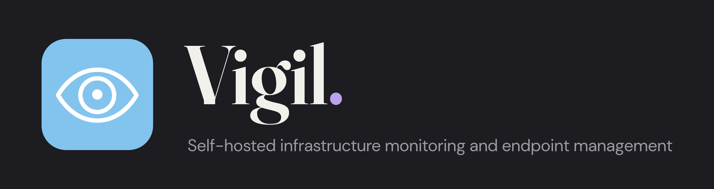

[Quick start](#quick-start) ·
[Tour](#a-tour-of-vigil) ·
[Security](#built-to-be-safe-to-run) ·
[Editions](#editions) ·
[Documentation](#documentation)

A [Susquehanna Syntax](https://github.com/Susquehanna-Syntax) product.

</div>

<br>

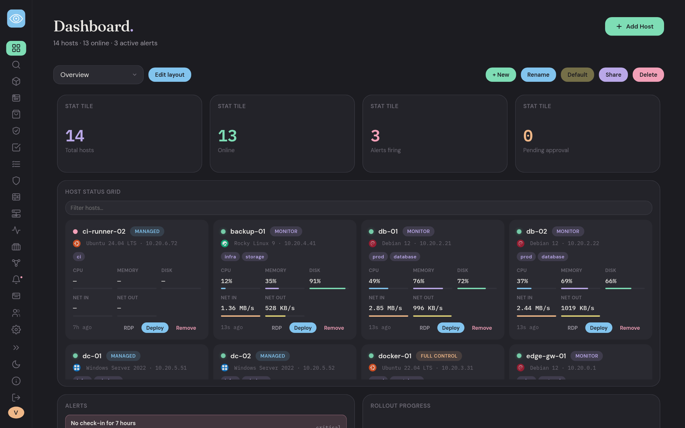

Vigil watches your machines and, when you want it to, changes them. A small
agent on each host checks in with a central server. The server collects
metrics, raises alerts, keeps a hardware and software inventory, finds
vulnerabilities, and sends **signed** tasks back to the agents to fix things:
patch an app, restart a service, clear a disk, rebuild a machine.

It runs on Linux, Windows and macOS hosts, installs with `docker compose up`,
and has no limit on hosts, agents or retention.

> Every screenshot below is a demo instance with made-up hosts and data.

## What is in the box

| | |
|---|---|
| **See** | Live dashboards, per-host monitoring, alerts, a hardware and software inventory, a network map |
| **Act** | Tasks in YAML, playbooks with if/else branches, automations on events and schedules, wave-by-wave rollouts |
| **Patch** | App and update policies with maintenance windows, approvals and SLA tracking |
| **Secure** | Vulnerability management with one-click fixes, firewall management, signed tasks, two-factor approval |
| **Operate** | Docker and Podman, remote reprovisioning, public status pages, Active Directory import |

## A tour of Vigil

### See everything

The **dashboard** is a grid of widgets you arrange, resize and name. Keep
several (an overview, a wall display, one per client) and share them. The host
cards show status, OS, tags, agent mode, and live CPU, memory, disk and network.

The **Monitor** page opens one host: gauges, load, and history from an hour to
a week.

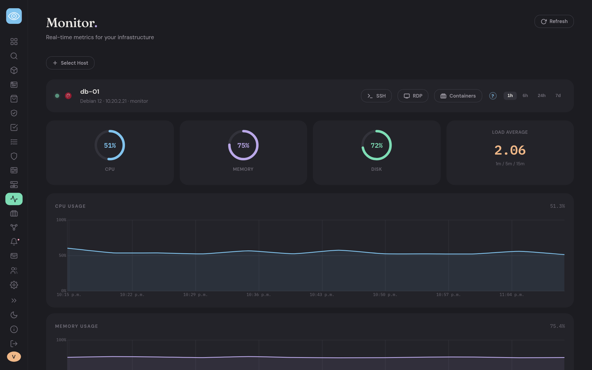

### Know what you own

The **Inventory** is a sortable, filterable table of every host: manufacturer,
model, CPU, RAM, BIOS, disks, MAC addresses, uptime, last logged-in user. Drag
columns into order, export to CSV, and add your own columns from the output of
a task. Tag hosts however you like and act on a whole tag at once.

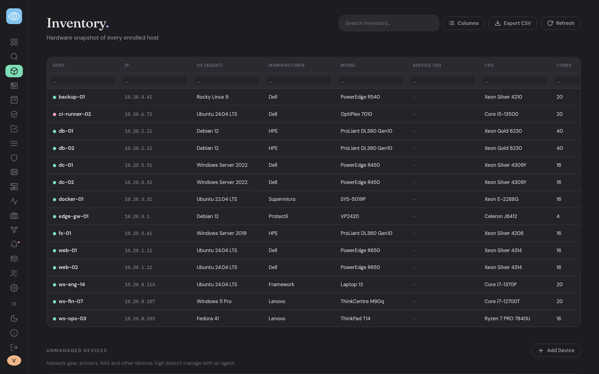

The **Apps** page lists every piece of software your hosts report, by app, by
host, or by the update it is missing. It reads dpkg, rpm, Flatpak, Snap, winget,
Chocolatey, Scoop and the Windows registry, and flags what is outdated or
unmanaged.

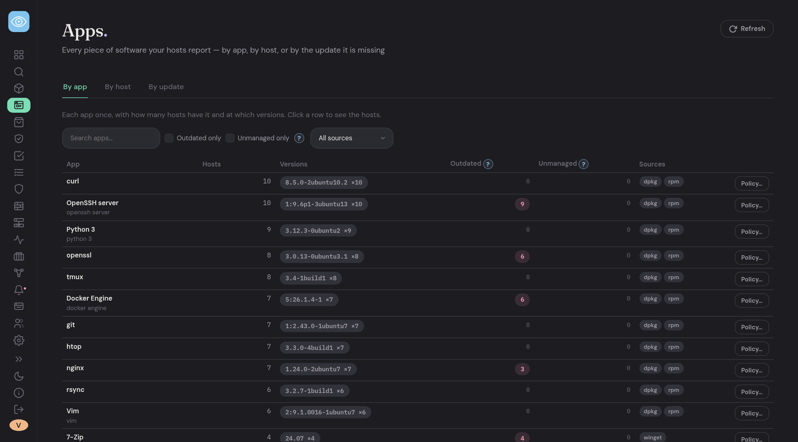

### Get told when something is wrong

Twenty alert rules ship ready to use, with auto-resolve and host-offline
detection. Alerts go out by webhook or email, can open tickets, and can be
acknowledged or snoozed. **Suggest Fix** drafts a remediation task for you to
review before it runs, using an AI model of your choice (bring your own key,
any OpenAI-compatible endpoint or Anthropic) when one is needed.

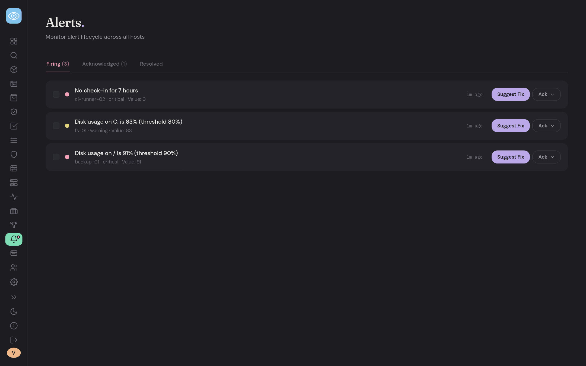

### Do things with tasks

A **task** is a short YAML file: a name, a risk level, and a list of actions
such as `restart_service`, `update_package`, `clear_temp_files` or
`hunt_process`. Deploy one to a host, a tag, or the whole fleet. Tasks can have
schedule windows, retries, success criteria, typed inputs asked for at deploy
time, and a `collect:` block that writes their output into the inventory.
Detection tasks hunt for files, packages, processes and ports. Browse and
submit to the [community catalog](https://github.com/Susquehanna-Syntax/Vigil-Approved-Scripts).

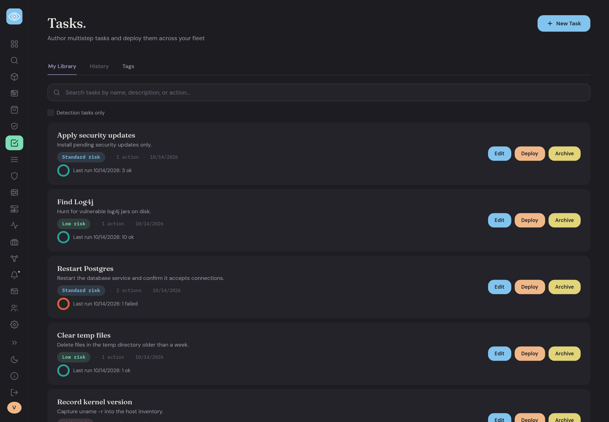

### Chain them into playbooks, with branches

A **playbook** runs tasks in order on a host, and it can decide what to do
next. Add **if / else** branches that read an earlier step's status or the
values its task reported, nest them up to three deep, let a step fail and carry
on, and pass inputs down from the playbook to its steps. The page draws the
flow as you build it.

This one finds out whether nginx is running. If it is, it updates it; if not,
it installs it. Then it verifies, and if the verify fails it reloads and tries
once more.

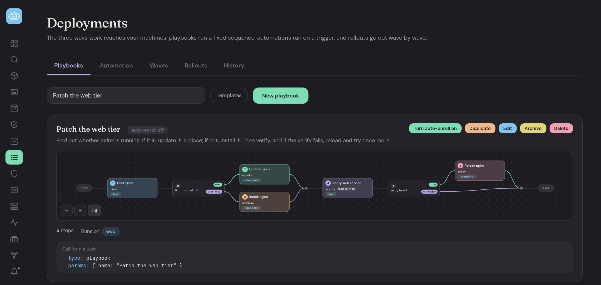

Branches nest, so a fallback can have its own decision inside it:

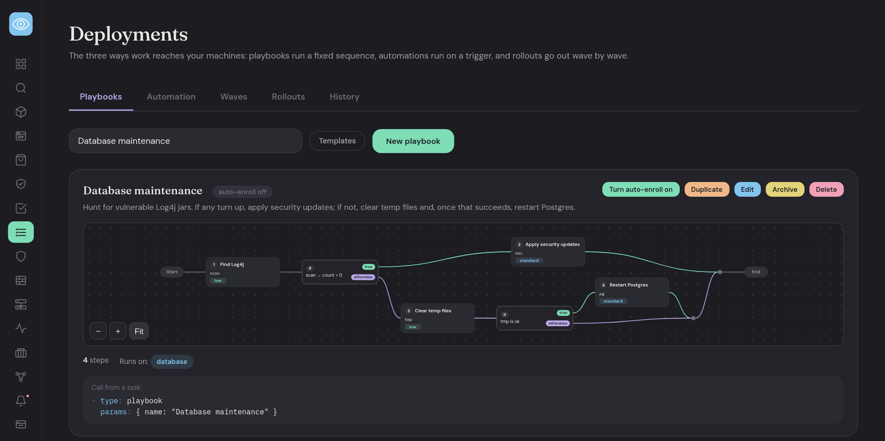

A playbook can run on its own when a matching host is approved (auto-enroll),
or be called from any task with `type: playbook`. Templates give you a head
start.

### Automate the reaction

An **automation** runs a task or a playbook when something happens, or on a
schedule. Triggers are events (an alert is sent, a host is approved) filtered by
severity, alert rule, text in the alert, or tag, or a cron schedule. Run it on
the host the event came from, on a tag, or on everything, either all at once or
**wave by wave** with automatic halting if too many hosts fail.

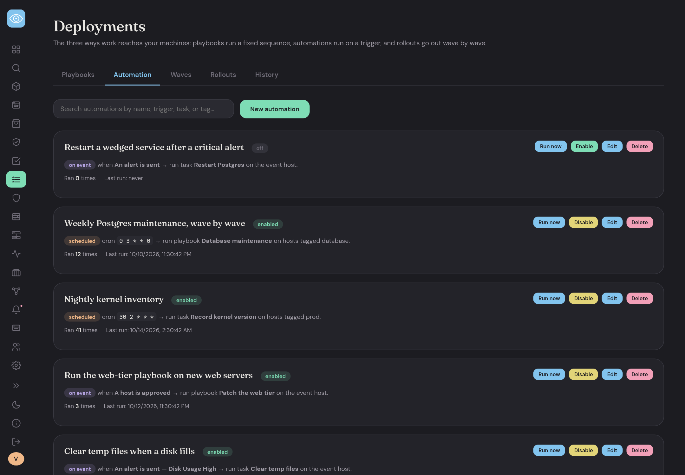

### Keep apps and updates in line

A **policy** says what a set of hosts should have: each app **present**,
**latest**, **pinned** to a version, or **absent**, plus which OS updates to
install, how long to defer them, and when hosts may restart. Vigil compares each
host against its policy and fixes drift only inside the maintenance window. Turn
on **approve each change** and the changes wait for a person instead. A
compliance view tracks the percentage of hosts patched within your SLA.

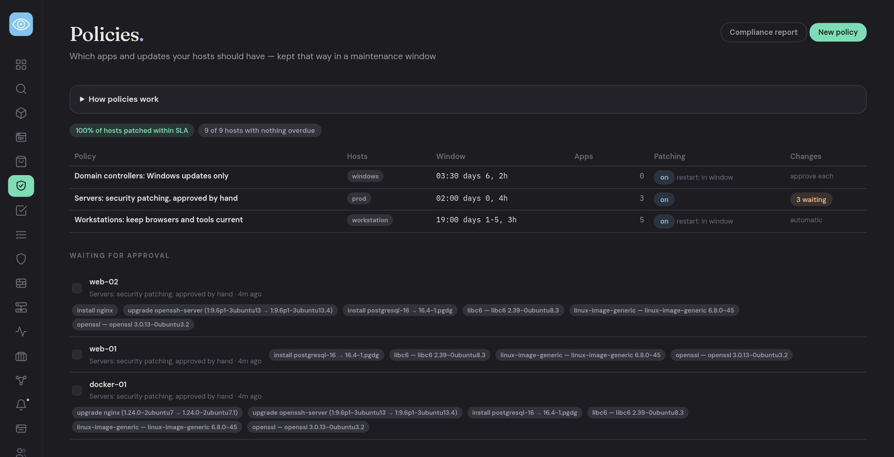

The **By update** view on the Apps page groups what hosts are missing by KB or
package. Approve or decline one update and it overrides every policy at once.

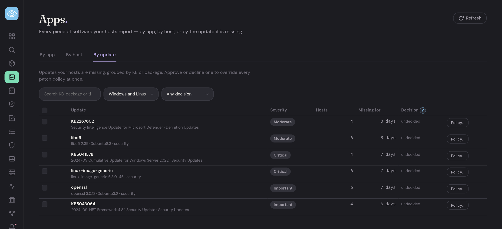

### Find and fix vulnerabilities

Findings come from Trivy, Nessus and Greenbone, plus Vigil's own matcher
against OSV, CISA KEV and EPSS that works offline. Findings are grouped by the
fix that resolves them, so one **Deploy fix** patches every affected host at
once.

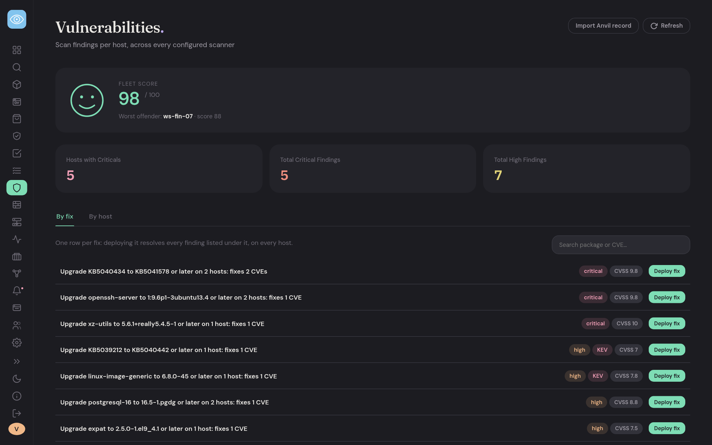

### Manage firewalls without locking yourself out

Read a host's firewall (ufw, firewalld, or Windows Firewall) on demand, change
the default policies, and add or remove rules. The page refuses the changes that
would lock you out: blocking the agent's own outbound connection, closing SSH
(or RDP on Windows), or defaulting incoming traffic to deny with no rule for it.

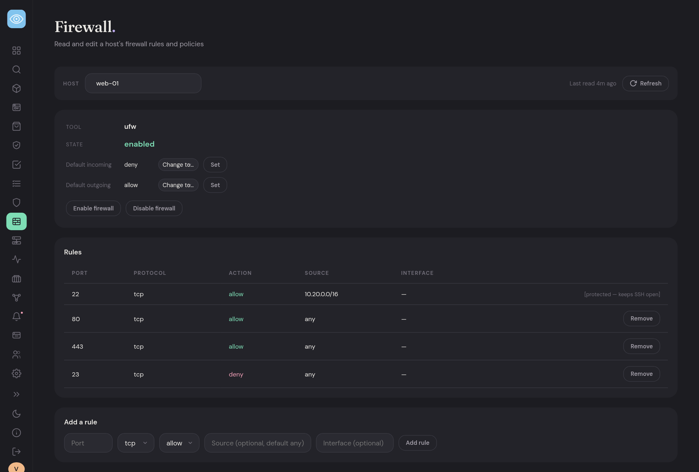

### Map your network

The **Topology** page groups your hosts by site and shows each one's address,
open ports, firewall state, compose stacks, and which hosts talk to which.

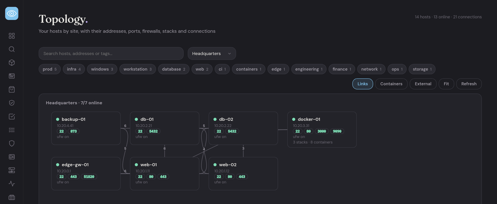

### Run containers

Docker and Podman containers and compose stacks across your hosts: start, stop,
restart, read logs, update images, roll back, and edit a stack and its `.env`
in place.

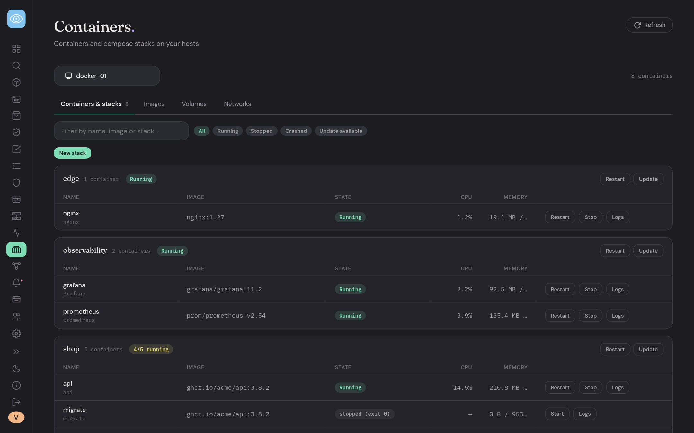

### Rebuild a machine from the dashboard

**Reprovision** keeps a library of OS images (Ubuntu, Debian and RHEL-family),
install profiles that answer everything the installer asks (disk, partitioning,
network, admin user, packages, tags to apply when done), and rebuild jobs that
reinstall a host unattended and bring it back enrolled. It destroys the target
disk, so it asks first.

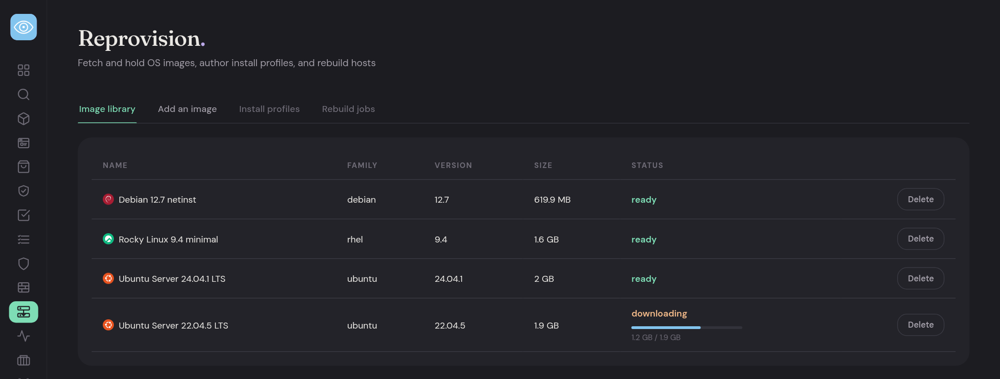

### Publish a status page

Share a public status page from the same data your monitoring already has.
Choose which hosts appear, give them customer-facing names, and the page shows
a 90-day uptime history for each. The first page is free; branding and per-site
pages are part of Business.

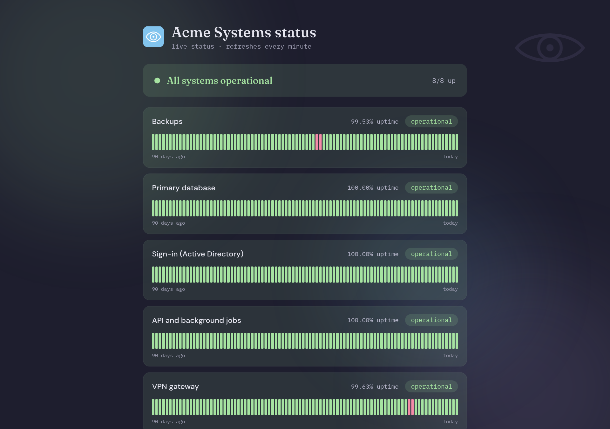

### Also included

- **Active Directory import** with automatic tags from OU paths.
- **Sites, roles and an audit log** (Business) to separate offices or clients,
  scope who can do what, and record who changed what.
- **Notifications** by webhook or email, and **Jackil** to turn an alert into a ticket.
- **Agent modes** so each host decides how much Vigil may do to it.

## Built to be safe to run

- Every task is **signed with Ed25519**. Agents pin the server key on first use
  and refuse tasks if it ever changes.
- Each agent runs in one of three modes, **monitor**, **managed** or **full
  control**, and the agent's own config is the final say. A compromised server
  cannot raise an agent's privileges. Monitor mode runs unprivileged.
- Risky steps and host approval can require a **TOTP code**, single-use with
  replay protection.
- No `shell=True` in the agent, and every task parameter is validated before it
  runs.

## Quick start

You need Docker with the Compose plugin.

```bash
git clone https://github.com/Susquehanna-Syntax/Vigil.git
cd Vigil
make setup        # copies .env.example to .env
make gen-key      # prints a signing key seed
make gen-secret   # prints a Django secret key
```

Open `.env` and paste in `VIGIL_SIGNING_KEY_SEED`, `DJANGO_SECRET_KEY`, and a
`POSTGRES_PASSWORD`. Then:

```bash
make up           # starts Django, TimescaleDB, Redis, Celery
make superuser    # create your admin login
```

Open **http://localhost:9200** and sign in.

> Pasting the stack into Portainer, or any UI that round-trips through YAML?
> Read the note on `VIGIL_SIGNING_KEY_SEED` in the
> [reference](docs/REFERENCE.md#quick-start-docker-compose) first. A mangled
> seed breaks every agent check-in.

### Add your first host

1. In the dashboard click **Add Host**, pick an operating system and a mode.
2. Copy the one-line install command it shows and run it on the machine:

   ```bash
   # Linux / macOS
   curl -fsSL https://vigil.example.com/agent/install.sh | sudo env VIGIL_TOKEN=<token> bash
   ```

   ```powershell
   # Windows, in an elevated PowerShell
   $env:VIGIL_TOKEN = "<token>"; irm https://vigil.example.com/agent/install.ps1 | iex
   ```

3. The host appears in **Settings → Enrollment Queue**. Approve it and metrics
   start flowing within a few seconds.

Start in **monitor** mode. You can move a host to managed or full control later
with one config line and a re-run of the installer.

### Your first task

Tasks are plain YAML. This one reloads nginx and checks that it came back:

```yaml
name: Reload nginx
description: Reload nginx and confirm it is active.
risk: low
actions:
  - id: reload
    type: reload_service
    params:
      service_name: nginx
  - id: verify
    type: check_service
    params:
      service_name: nginx
      expect: active
```

Paste it into **Tasks**, pick a host or a tag, and deploy.

### Running without Docker

For a quick look on a laptop, Vigil runs on SQLite with no other services:

```bash
cd server
python3 -m venv .venv && .venv/bin/pip install -r requirements.txt
export USE_SQLITE=true
.venv/bin/python manage.py migrate
.venv/bin/python manage.py createsuperuser
.venv/bin/python manage.py runserver
```

This is for development. Use the Compose stack for anything real.

## Editions

Free Vigil answers "is my stuff up"; Business Vigil answers "can I prove to a
third party that their stuff is up." Monitoring, alerting, and unlimited
agents, hosts, and retention are free forever. The Business tier adds
accountability features: sites, an audit log, roles, and branding. Nothing ever
blocks: an expired license switches Business features off and monitoring
carries on untouched. See [docs/EDITIONS.md](docs/EDITIONS.md) for the full
feature matrix.

## Documentation

| | |
|---|---|
| [Reference manual](docs/REFERENCE.md) | Install options, environment variables, upgrading, backups, every task action, the API |
| [Agent privileges](docs/AGENT-PRIVILEGES.md) | What each agent mode can and cannot do |
| [Remote access](docs/REMOTE-ACCESS.md) | Checking in from off the LAN, reverse proxy, Cloudflare Tunnel |
| [Reprovisioning](docs/reprovisioning.md) | Rebuilding hosts from an image library |
| [Roles and permissions](docs/rbac.md) | Who can do what |
| [Security policy](.github/SECURITY.md) | Reporting a vulnerability |
| [Contributing](.github/CONTRIBUTING.md) | Inbound license, sign-off, and how to send a change |

## License

AGPLv3. The Business features are a separate package under a commercial
license: official images include it compiled, it needs a Vigil Business
subscription for production use, and its source is available to customers for
audit on request. A build from this repo is the AGPL core. See [LICENSE](LICENSE)
and [docs/EDITIONS.md](docs/EDITIONS.md).
